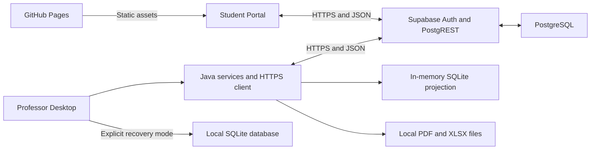
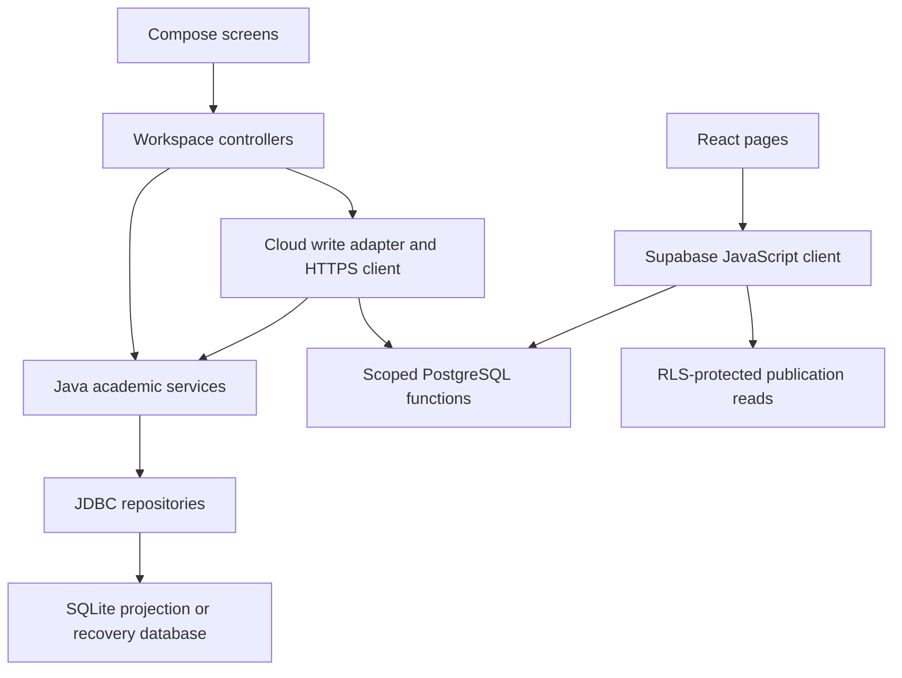

# Professor OS

Professor OS is an academic workspace for university faculty, with a companion Student Portal. Faculty manage teaching records in the Windows desktop app. Students can view their authorized courses, lectures, attendance, and published grades online.

[Download the Windows x64 installer](https://github.com/retinazer21/ProfessorOS/releases/download/v1.1.1/Professor.OS-1.1.1.exe) · [Release notes and checksum](https://github.com/retinazer21/ProfessorOS/releases/tag/v1.1.1) · [Open the Student Portal](https://retinazer21.github.io/ProfessorOS/)

## Key features

- Manage terms, course offerings, rosters, enrollments, and lectures.
- Edit attendance in Lecture and Matrix views with batch saves and conflict detection.
- Maintain weighted gradebooks and publish reviewed final grades explicitly. Draft grades remain private.
- Build exams from a question bank and export separate student papers and answer keys as PDFs.
- Preview Excel roster imports before confirmation and export saved grades and attendance as XLSX.
- Use ten shared themes and open a separate local SQLite workspace for recovery.

## System architecture

PostgreSQL is the source of truth for the online workspace. Both clients communicate independently with Supabase. GitHub Pages serves the browser app, while Supabase handles identity, authorization, and data requests.

## Technology stack

| Technology | Purpose |
| --- | --- |
| Kotlin and Compose Desktop | Native faculty workspace, keyboard editing, and UI state |
| Java 25 and JDBC | Academic rules, persistence adapters, and desktop integration |
| Supabase Auth and PostgREST | Password and TOTP authentication, HTTPS data endpoints, and database function calls |
| PostgreSQL | Shared records, transactions, constraints, and row-level policies |
| SQLite | In-memory projection for online service reuse and a separate on-disk recovery workspace |
| React, TypeScript, and Vite | Typed, responsive browser application and static build |
| Apache PDFBox and Apache POI | Local PDF rendering and XLSX import/export |
| Maven, Gradle, jpackage, and WiX | Java build, Compose build, and Windows installer packaging |
| GitHub Actions and Pages | Verified static build and manually dispatched Portal deployment |

## Layered code architecture

Screens handle interaction, controllers coordinate actions, services apply academic rules, and repositories handle persistence. For supported online writes, the cloud adapter runs the existing Java operation in a disposable SQLite projection, sends the before-and-after values to a scoped PostgreSQL function, and updates the displayed projection after server confirmation.

| Repository area | Responsibility |
| --- | --- |
| [Desktop](prototype-compose/) | Compose screens, controllers, tests, and native build configuration |
| [Java application](src/main/java/com/professoros/) | Domain records, services, repositories, and PDF/Excel processing |
| [SQLite migrations](src/main/resources/db/migrations/) | Versioned recovery and projection schema |
| [Student Portal](student-portal/) | React interface, Auth integration, and academic views |
| [Supabase migrations](student-portal/supabase/migrations/) | Hosted schema, RLS, and database APIs |
| [Tools](tools/) and [documentation](docs/) | Packaging, import tooling, verification, and operating guides |

## Database and consistency

A **course offering** combines a course, academic term, and section. An **enrollment** links a student to an offering, and lectures belong to that offering. An attendance record is keyed by enrollment and lecture. Composite foreign keys ensure the enrollment and lecture refer to the same offering. A gradebook score relates an enrollment and an assessment. A published grade is stored separately and keyed by offering and the student's Auth identity.

The hosted schema separates portal roles and publications, imported academic relationships, and private faculty records. UUIDs identify cloud records, stable numeric IDs support the desktop projection, and an explicit account link connects a roster student to an Auth identity. Hosted and SQLite schema changes use separate versioned migrations. The SQLite runner checks applied migration checksums.

Attendance saves compare expected statuses in one transaction. A conflict rolls back the batch. An unmarked cell has no row, while an absence is an explicit mark. Grade publication compares a UUID revision to avoid overwriting a newer result.

## Cybersecurity

| Mechanism | What it protects |
| --- | --- |
| **MFA and TOTP** | A password starts a lower-assurance session. A verified time-based authenticator code is required for protected access. |
| **JWT and refresh credentials** | Signed access tokens identify sessions and expire. The database also checks that the Auth session remains valid. Refresh credentials renew sessions. |
| **RLS and scoped SQL functions** | Server-side checks restrict records to enrolled students or assigned faculty. Client-side routes and filters do not grant access. |
| **Windows DPAPI** | Protects the desktop's saved refresh credential at rest for the current Windows user. Normal closure preserves it. Explicit sign-out clears it and requests session-local revocation. |
| **HTTPS and public client keys** | HTTPS protects requests in transit. Shipped clients use a publishable project key, with access scoped by the authenticated user. |
| **SQL injection prevention** | Prepared JDBC statements bind data separately from SQL. Database APIs accept typed arguments and use scoped queries. |

## Installation, testing, and deployment

1. Download the Windows x64 EXE from the [1.1.1 release](https://github.com/retinazer21/ProfessorOS/releases/tag/v1.1.1) and compare its SHA-256 with the release notes.
2. Close any running Professor OS instance, run the installer, and launch **Professor OS** from Start. Java is bundled.
3. Sign in with a provisioned faculty account and a current authenticator code. The online workspace requires an internet connection.

The Student Portal runs in a browser and also requires a provisioned account and MFA. For development, use JDK 25 for the desktop and Node.js 24 for the portal. Maven builds the Java library, Gradle builds Compose, and Vite builds the portal. [Desktop source build](docs/WINDOWS_PACKAGING.md) · [Portal source build](student-portal/README.md)

JUnit tests cover service rules, database behavior, and documents. Compose tests exercise editing and conflict handling. Portal and SQL tests cover access rules and application behavior. The Windows 1.1.0 release record reports 234 Java tests, 49 Compose tests, and installed-app smoke testing. The [Pages workflow](.github/workflows/student-portal-pages.yml) checks and builds the portal before an explicitly requested deployment. Desktop releases and database migrations are separate operations.

## Technical FAQ

### Why use SQLite when PostgreSQL holds the online records?

The in-memory projection lets the desktop reuse its existing Java services. The separate on-disk database supports explicit local recovery via `--recovery`. Recovery edits do not automatically synchronize.

### Why separate saving from publishing a grade?

Faculty can correct private grades without exposing incomplete work. Publication is an explicit, revision-checked operation. Java calculates the result and the server validates the publication request.

### What happens if two users edit the same record?

The server checks the previously read value or revision. A stale request returns a conflict for review. A network timeout leaves the outcome uncertain until the server is checked.

### What are the current limitations?

The private desktop workspace uses a single-owner model and loads a full projection. Recovery and online data do not merge automatically. Windows 1.1.1 is an unsigned x64 prerelease. Physical reboot and clean-machine testing remain pending.
